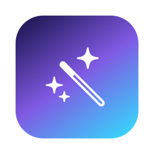
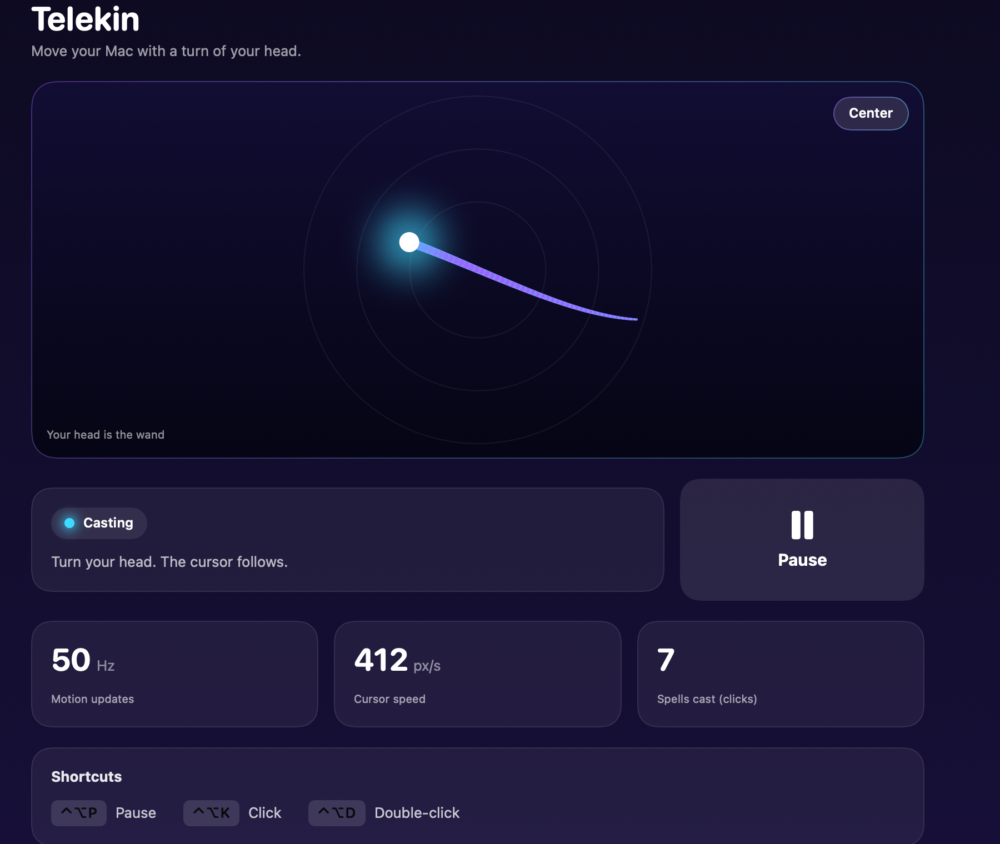
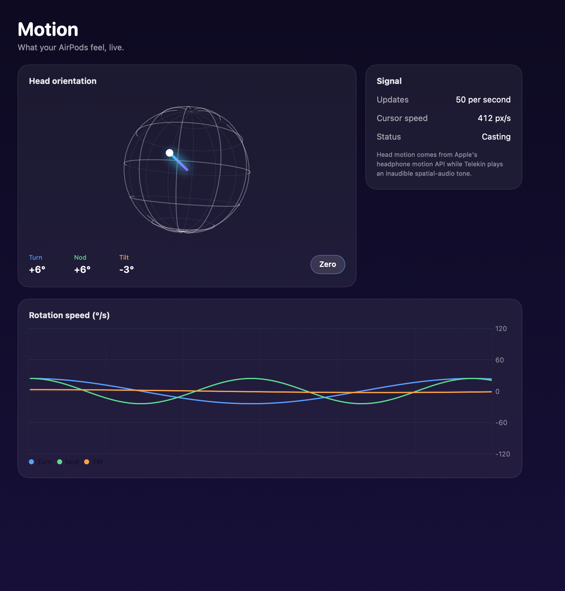
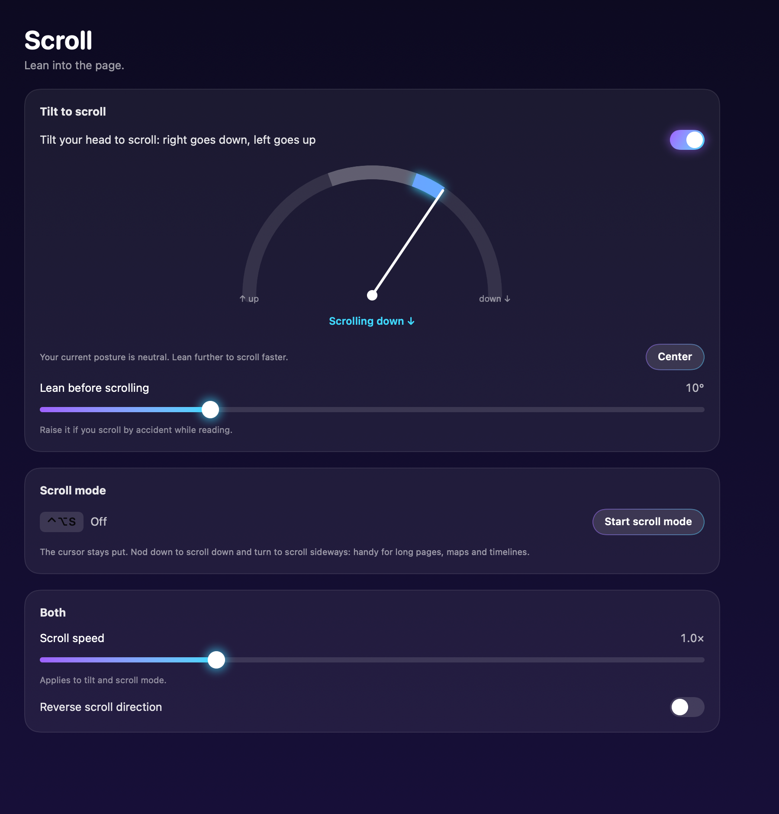

<p align="center">
  
</p>

<h1 align="center">Telekin</h1>

<p align="center">
  <b>Move your Mac cursor with your AirPods.</b><br>
  Turn your head, and the cursor follows. Hold still, and it clicks. No hands on the trackpad.
</p>

<p align="center">
  
  
  
</p>

<p align="center">
  
</p>

## What it does

- **Steer with your head.** Turn left or right to move the cursor sideways, and look up or down to move it up or down. Quick turns travel further; slow ones stay precise.
- **Click without touching anything.** Hold still for 1 second to click, or keep holding to 2 seconds to double-click. Keyboard shortcuts work too.
- **Scroll hands-free.** Tilt your head (ear toward shoulder) to scroll: right goes down, left goes up, and leaning further scrolls faster. Or press ⌃⌥S for scroll mode, where nodding and turning scroll the page while the cursor stays put.
- **AirPods press (experimental).** Press the stem once to click and twice to double-click.
- **Spell trail.** Sparkles follow the cursor while you steer, and every click bursts into light. The sparkles never block what you click.
- **See what your AirPods feel.** A live 3D head globe and rotation-speed chart.
- **Open at login.** Turn it on in Feel or the menu bar, and Telekin is ready whenever your AirPods are.
- **Spoken labels.** Controls, gauges and charts in the window have names for VoiceOver and Voice Control.

<p align="center">
  
  
</p>

## Requirements

| | |
|---|---|
| Mac | Apple Silicon, macOS 15 Sequoia or later |
| Headphones | AirPods with head tracking: AirPods (3rd gen), AirPods Pro, AirPods 4 or AirPods Max. Tested on AirPods (3rd gen). |
| To build | Xcode or the Command Line Tools (`xcode-select --install`) |

## Install

1. Download **Telekin-1.0.zip** from the [latest release](https://github.com/haifa-jundi/telekin/releases/latest) and double-click it to unzip.
2. Drag **Telekin.app** into your **Applications** folder.
3. Open Telekin. macOS stops it with *"Apple could not verify Telekin is free of malware"*. Click **Done**, not Move to Bin.
4. Open **System Settings › Privacy & Security**, scroll down to *"Telekin was blocked to protect your Mac"*, and click **Open Anyway**. Confirm with your password.

You only do steps 3 and 4 once.

> **Why the warning?** Telekin is a free, open-source app that isn't registered with Apple (that costs $99 a year), so macOS can't vouch for it. You can read every line of the code here, or build it yourself below.
>
> Comfortable with Terminal? This skips steps 3 and 4: `xattr -dr com.apple.quarantine /Applications/Telekin.app`

**Updating:** quit Telekin, replace the app in Applications with the new one, and open it again. Every release is signed with the same certificate, so macOS keeps your permissions.

## Build from source

```bash
git clone https://github.com/haifa-jundi/telekin.git
cd telekin
zsh build.sh
open Telekin.app
```

`build.sh` compiles the app, signs it, and runs the built-in self-test. Without the project's signing certificate it signs the app for your Mac only.

## First launch

Telekin opens on **Setup**, which walks you through three steps:

1. **Motion & Fitness:** allow Telekin to read head motion.
2. **Accessibility:** allow Telekin to move the cursor and click.
3. **Wear your AirPods** and choose them as the sound output.

Then turn your head. Telekin lives in the menu bar (the wand icon); open its window from there.

> **Built it yourself and the cursor stopped moving after a rebuild?** Builds signed for your Mac only look like a new app to macOS each time. Remove Telekin from the Accessibility list and add it again, or run `tccutil reset Accessibility io.github.haifa-jundi.telekin`.

## Shortcuts

| Keys | Action |
|---|---|
| ⌃⌥P | Pause or resume |
| ⌃⌥K | Click (while casting) |
| ⌃⌥D | Double-click (while casting) |
| ⌃⌥S | Scroll mode on or off |

## How it works

macOS shares AirPods head motion with apps through Apple's public headphone-motion API, but only while the app plays spatial audio. Telekin plays an inaudible spatial-audio tone, reads your head's turn and nod about 50 times a second, and turns the changes into cursor motion:

- A **soft dead zone** ignores tiny drift and tremor.
- **Acceleration** makes fast turns go further.
- A 120 Hz **glide** smooths the 50 Hz motion so the cursor doesn't step.
- **Tilt scrolling** measures tilt from your own neutral posture, which slowly follows you while you stay inside the dead zone, so leaning a little while reading never scrolls.

Clicks are ordinary mouse events, which is why Telekin needs the Accessibility permission. Nothing leaves your Mac: no network, no analytics.

## Project layout

```text
Sources/
  App/        Startup, settings, the pointer controller and the window's live model
  Mapping/    Head motion to cursor and scroll math, dwell clicks, and the offline self-test
  Runtime/    AirPods motion, cursor events, hot keys, AirPods presses, spell trail
  UI/         The SwiftUI window: Wand, Motion, Clicks, Scroll, Feel, Setup, About
Tools/        Icon generator and release packaging (release.sh)
```

Developer commands:

```bash
Telekin.app/Contents/MacOS/Telekin --self-test                          # mapping and click logic
Telekin.app/Contents/MacOS/Telekin --render-screenshots docs/screenshots  # redraw README images
```

## Known limits

- **AirPods must be in your ears.** The motion sensors switch off in the case.
- **Stem-press clicking is experimental.** While Telekin is casting, a press clicks instead of pausing music; pause Telekin to get play/pause back.
- **No right-click or drag yet.**

## Thanks

Inspired by [MousePods](https://github.com/starman-tech/mousepods) by Matteo Gaudioso (starman-tech), which first showed AirPods (3rd gen) can drive a cursor, on Linux. Telekin is a separate macOS app and shares no code with it.

## License

[MIT](LICENSE). Not affiliated with Apple. AirPods is a trademark of Apple Inc.
